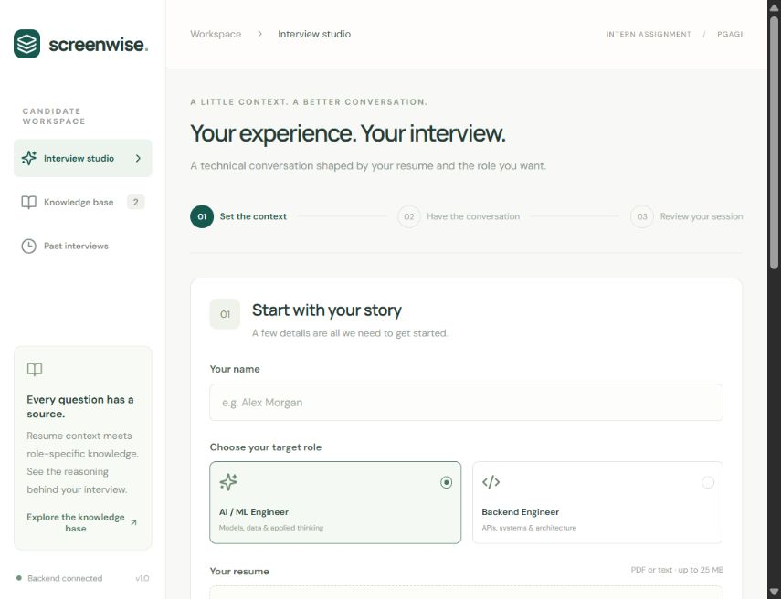
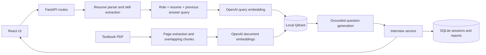

# Screenwise

A local, resume-aware technical interview app built for the **PGAGI AI/ML & Backend Intern Assignment**. Upload a resume, choose a role, answer contextual questions, and review the saved conversation with the exact knowledge passages used for each question.

**Stack:** React + Vite, FastAPI, SQLite, local Qdrant, OpenAI embeddings and question generation. No Docker, cloud database, authentication service or deployment needed.



## Quick start (Windows)

Prerequisites: **Python 3.11+** and **Node.js 20.19+ or 22.12+**.

From the repository root:

```powershell
powershell -ExecutionPolicy Bypass -File scripts/setup.ps1
powershell -ExecutionPolicy Bypass -File scripts/start.ps1
```

Open **http://localhost:5173**. Interactive API documentation: **http://localhost:8000/docs**.

The default configuration is a **clearly labeled offline demo**. It uses hashed word/bigram vectors and deterministic questions so you can check uploads, retrieval, answers, persistence and reports without a key. **This mode does not satisfy the assignment's non-template AI question-generation requirement. Use OpenAI mode for your company demonstration.**

Try `samples/resume_ml.txt` or `samples/resume_backend.txt`. Pick three questions for a short demo. The app accepts text-based PDF resumes too.

## Enable OpenAI for the actual assignment

Setup creates `.env` from `.env.example`. Edit the root `.env`:

```dotenv
LLM_PROVIDER=openai
EMBEDDING_PROVIDER=openai
OPENAI_API_KEY=your_key_here
OPENAI_MODEL=gpt-4o-mini
OPENAI_EMBEDDING_MODEL=text-embedding-3-small
```

Restart the backend after changing configuration. Never put the API key in React code or commit `.env`. The browser calls FastAPI; only FastAPI contacts OpenAI. Embedding the knowledge base, resume-derived retrieval queries and question generation use the API and may incur charges. Resume context and previous answers are sent to the configured generation provider.

1. Download a textbook linked in the assignment (helper below), or use your own authorized copy.
2. Open **Knowledge base**, select **AI / ML Engineer**, and upload the textbook.
3. Wait for indexing to complete. A full book can take a few minutes on first ingestion.
4. Start an interview using `samples/resume_ml.txt` or your resume.
5. Expand **View retrieval trace** to see the query, source file, page, similarity and retrieved passages. The model identifies the passages it cited.

Provider failures are surfaced as errors; the app never silently switches to demo generation. If a next-question request fails, the current answer remains in the browser draft and the server session stays retryable. Do not use this private local prototype with multiple users or expose it to the internet.

## Assignment textbooks

The assignment links these author/publisher-hosted copies:

- [Pattern Recognition and Machine Learning, Christopher Bishop](https://www.microsoft.com/en-us/research/wp-content/uploads/2006/01/Bishop-Pattern-Recognition-and-Machine-Learning-2006.pdf) — a provided optional advanced source, readable by the parser.
- [Machine Learning, Tom Mitchell](https://www.cs.cmu.edu/~tom/files/MachineLearningTomMitchell.pdf) — the provided primary source; this copy may require OCR and can exceed the UI upload limit.

Download the Bishop copy without adding it to Git:

```powershell
.\.venv\Scripts\python.exe scripts/fetch_textbook.py --book bishop
```

Upload it through the UI, or **stop the backend first** and index it directly:

```powershell
.\.venv\Scripts\python.exe scripts/ingest_book.py knowledge/ml/Bishop-Pattern-Recognition-and-Machine-Learning-2006.pdf --role ml
```

The CLI supports documents up to 100 MB; the HTTP upload limit is 25 MB. Neither path performs OCR. Do not upload a scanned PDF without readable text. PDF page references refer to the PDF's 1-based page index, which can differ from printed page numbers.

Books are not redistributed in Git. `knowledge/ml/foundations.md` and `knowledge/backend/foundations.md` are short original demonstration notes, labeled as such. They are automatically indexed only in offline hash mode. OpenAI mode starts with an empty index until you upload a source. Changing the embedding provider or model creates a separate Qdrant collection; upload or ingest the book again for that configuration.

## Run manually / macOS / Linux

```bash
python -m venv .venv
# Windows:
.venv/Scripts/python -m pip install -r backend/requirements-dev.txt
# macOS/Linux: use .venv/bin/python instead
```

Copy `.env.example` to `.env` if missing. In separate terminals from the repository root:

```bash
# Terminal 1 (Windows; use .venv/bin/python on macOS/Linux)
.venv/Scripts/python -m uvicorn backend.app.main:app --host 127.0.0.1 --port 8000
```

```bash
# Terminal 2
cd frontend
npm ci
npm run dev -- --port 5173 --strictPort
```

Keep one backend worker because Qdrant local mode owns a directory lock. Do not run the CLI ingester while the backend is running. Stop the existing process if port 8000 or 5173 is occupied.

Optional local model support: set `LLM_PROVIDER=ollama` and `EMBEDDING_PROVIDER=ollama`, install Ollama, then pull the models in `.env.example` (`ollama pull llama3.2` and `ollama pull nomic-embed-text`). The OpenAI setup above is the intended submission path.

## Architecture



### Main design decisions

- **220-word chunks, 45-word overlap, page boundaries preserved.** Small enough for precise retrieval; overlapping windows preserve nearby context. Chunks do not cross pages so source references remain accurate. This can split cross-page explanations, a deliberate simple tradeoff.
- **Persistent Qdrant, cosine top-4 search, role filters.** A real vector database in embedded local mode keeps setup small. OpenAI embeddings give semantic retrieval. The offline hashing fallback is lexical and explicitly marked as demo. No reranker or arbitrary confidence threshold; the UI exposes similarity so retrieval can be inspected rather than claiming it proves relevance.
- **Resume-aware queries and prompts.** Skills, project lines, selected role and previous answer construct each query. A simple experience-years heuristic sets initial difficulty. The LLM receives the resume, current context and prior answers to generate a specific, non-repeated question and adapt the next one. Extraction is rule-based and can miss skills or misread dates; it is not a trained resume parser.
- **Grounded structured generation.** The provider must return JSON with a question, topic, rationale, expected concepts and IDs of retrieved sources. Pydantic checks the shape and bounds; source IDs must belong to retrieved passages. We retain both all retrieved passages and the cited IDs. This checks traceability, not factual correctness; hallucination and weak retrieval remain possible.
- **SQLite for interview state.** Each session stores a JSON document containing profile, questions, answers, retrieval trace and final report. This is easier to inspect for a small assignment than a large ORM schema. Database columns support listing sessions. A single-process lock serializes mutations; the current question ID rejects duplicate/stale submissions.
- **Honest review insights.** Reports show topic coverage, response word counts, literal expected-concept matches and suggested review prompts. They do not claim to grade correctness or make hiring decisions. Expected concepts are hidden from the candidate API until completion.
- **Small service modules.** Routes validate requests; resume parsing, vector retrieval, generation, interview lifecycle and persistence are separate modules. Environment variables select providers and model versions.

## Repository layout

```text
backend/app/
  main.py           FastAPI lifecycle, routes and validation
  config.py         Root .env and provider settings
  resume.py         PDF/text parsing and rule-based profile extraction
  knowledge.py      Chunking, embeddings and local Qdrant retrieval
  generation.py     OpenAI/Ollama generation and transparent review insights
  interview.py      Interview state transitions and retrieval queries
  storage.py        SQLite persistence
backend/tests/      Isolated lifecycle and provider-contract tests
frontend/src/       React screens and responsive styles
knowledge/          Original demo notes; ignored local textbook PDFs
samples/            Fictional resumes for the demo
scripts/            Setup, start, textbook download and ingestion
docs/               Demo script and requirements checklist
```

## API

| Method | Endpoint | Purpose |
| --- | --- | --- |
| GET | `/api/health` | Current provider configuration (does not test provider credentials) |
| GET / POST | `/api/knowledge` | List sources / upload and index a role-specific source |
| GET / POST | `/api/sessions` | List interviews / create from multipart resume + role + name |
| GET | `/api/sessions/{id}` | Resume an interview or fetch its final report |
| POST | `/api/sessions/{id}/answers` | Save current answer and generate next question / finish |
| GET | `/api/sessions/{id}/export` | Download session and trace as JSON |

## Checks

```powershell
.\.venv\Scripts\python.exe -m pytest -q
cd frontend
npm run build
```

Tests use temporary directories and no real API key. They cover the full interview lifecycle, disk persistence across app restarts, report/export, stale submissions, validation, role filtering, document replacement, PDF rejection and provider failure/retry. OpenAI request/response contracts are tested with a mock HTTP transport. A passing mock test **does not verify a real API key or live model quality**. Run the textbook + OpenAI flow yourself before recording the mandatory company demo.

See [docs/VALIDATION.md](docs/VALIDATION.md) for the checks performed on this project.

## GitHub and submission

Review the source and README, then create an empty GitHub repository. From this folder:

```bash
git init
git add .
git status
git commit -m "Build resume-aware RAG interview assignment"
git branch -M main
git remote add origin YOUR_GITHUB_REPOSITORY_URL
git push -u origin main
```

`.gitignore` excludes API keys, candidate data, downloaded textbooks, model/vector data, dependencies, logs and build output. `frontend/package-lock.json` is included. Do not add your real resume or downloaded books to the repository. The sample resumes are fictional.

Record the **mandatory end-to-end demo video** using [docs/DEMO.md](docs/DEMO.md). The assignment mapping and prototype limits are in [docs/ASSIGNMENT_CHECKLIST.md](docs/ASSIGNMENT_CHECKLIST.md). This is an intentionally small local assignment project: no authentication, multi-user isolation, hosted deployment or production scaling.
